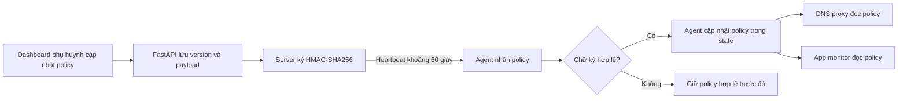
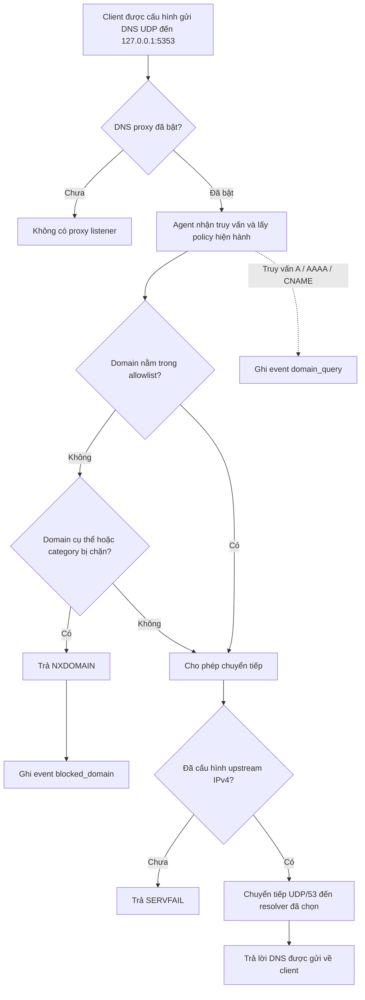
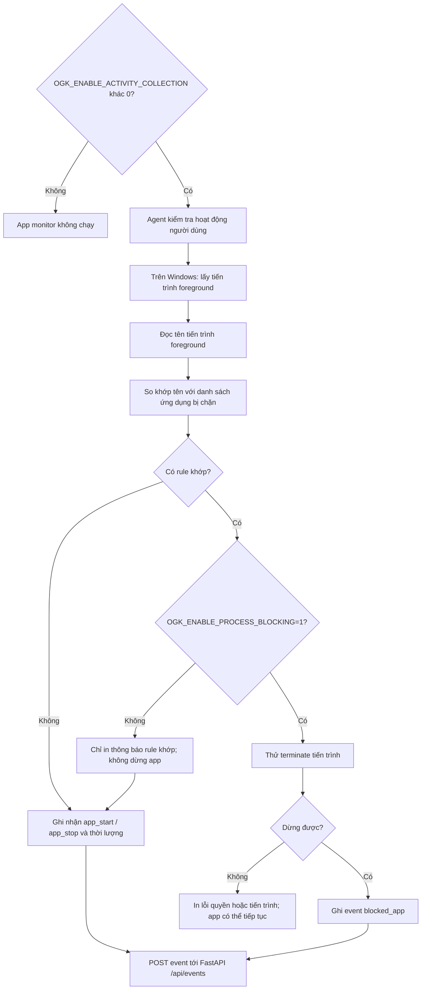

# Pipeline: chặn domain và ứng dụng trên máy trẻ

Tài liệu này mô tả luồng prototype đang có trong `agent/dns_proxy.py`, `agent/activity_monitor.py` và `agent/main.py`. Các sơ đồ là luồng trong môi trường lab; chúng không khẳng định máy trẻ đã được bảo vệ toàn diện.

## 1. Policy đến agent



Policy phải đến agent trước khi worker áp dụng quy tắc. Nếu server mất kết nối, agent giữ policy cache đang có. App monitor và DNS proxy bật mặc định; có thể tắt lần lượt bằng `OGK_ENABLE_ACTIVITY_COLLECTION=0` và `OGK_ENABLE_DNS_PROXY=0`.

## 2. Pipeline lọc domain qua DNS



**Thứ tự áp dụng:** allowlist cố định và allowlist policy được kiểm tra trước; domain được cho phép sẽ không bị chặn bởi domain rule/category. Nếu không được allow, proxy kiểm tra domain bị chặn trực tiếp và category từ `shared/domain_catalog.py`. Domain không được phân loại sẽ có category `unclassified`.

**Giới hạn:** proxy chỉ lắng nghe UDP trên loopback và chỉ xử lý truy vấn được gửi tới đúng cổng. Agent không tự đổi DNS của Windows. Catalog gồm 200 domain fixture `.test`; các category này không phải đánh giá website thật. Domain được phép chỉ được forward khi người vận hành chỉ định upstream IPv4; upstream đó sẽ nhìn thấy tên miền được truy vấn. Chưa có TCP fallback, DoH/DoT, VPN hay cơ chế buộc mọi ứng dụng dùng proxy.

## 3. Pipeline phát hiện và chặn ứng dụng



Monitor lấy mẫu foreground khoảng mỗi 5 giây khi người dùng đang hoạt động. Rule khớp theo tên tiến trình, không phân biệt hoa thường; phụ huynh nhập tên như `chrome` hoặc `msedge`, không cần `.exe`, đường dẫn hay hash. Monitor không đọc file executable, tiêu đề cửa sổ, phím gõ hay nội dung ứng dụng. Nếu chỉ bật thu thập activity mà không bật cờ process blocking, rule khớp chỉ tạo thông báo và app vẫn chạy.

## 4. Dữ liệu event và báo cáo

| Luồng | Event chính | Dữ liệu được gửi |
|---|---|---|
| DNS được tra cứu | `domain_query` | Domain gốc gần đúng, không gồm URL path |
| DNS bị chặn | `blocked_domain` | Domain gốc gần đúng |
| App đổi foreground | `app_start`, `app_stop` | Tên executable và thời lượng |
| App bị terminate theo rule | `blocked_app` | Tên executable |

Agent gửi các event qua `POST /api/events`; server lưu trong SQLite và API report tổng hợp thời lượng, top app/domain và số lần bị chặn.

## 5. Cờ bật trong demo

```powershell
$env:OGK_ENABLE_DNS_PROXY = '1'
$env:OGK_DNS_PORT = '5353'
$env:OGK_DNS_UPSTREAM = 'IP_CUA_RESOLVER_LAB_DUOC_PHEP'

$env:OGK_ENABLE_ACTIVITY_COLLECTION = '1'
# Chỉ bật trên máy lab được phép; mặc định app không bị terminate.
$env:OGK_ENABLE_PROCESS_BLOCKING = '1'
```

App monitor và DNS proxy bật mặc định ở bản hiện tại; đặt biến tương ứng bằng `0` để tắt. DNS proxy chỉ nghe loopback, không đổi DNS Windows và không tự nhận truy vấn từ các ứng dụng. Chỉ dùng trên máy lab do bạn quản lý và khi đã có sự đồng ý phù hợp. Đừng đổi DNS toàn hệ thống chỉ để chạy demo.
