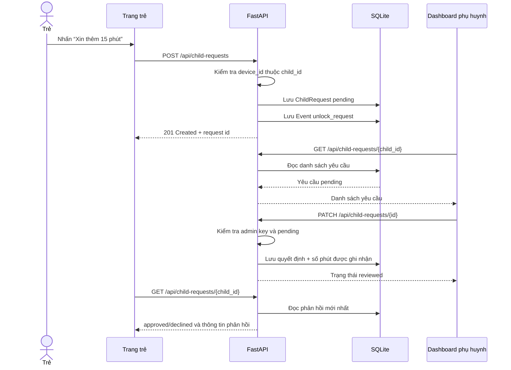

# Pipeline: trẻ xin thêm thời gian sử dụng máy

Sơ đồ mô tả luồng hiện có trong prototype từ lúc trẻ gửi yêu cầu đến khi xem phản hồi. Các bước và API được đối chiếu với `server/app/main.py` và model `ChildRequest` trong `server/app/models.py`.

## Sơ đồ luồng

```mermaid
flowchart TD
    A[Trẻ mở trang /child/demo-child] --> B[Chọn Xin thêm 15 phút]
    B --> C[Trình duyệt gửi POST /api/child-requests\nchild_id, device_id, kind=extra_time]
    C --> D{Thiết bị đã ghép\nđúng hồ sơ trẻ?}
    D -- Không --> E[Server trả lỗi 404]
    D -- Có --> F[Tạo ChildRequest\nstatus=pending]
    F --> G[Ghi Event unlock_request\nsubject=screen_time]
    G --> H[Commit vào SQLite\ntrả request id + trạng thái]
    H --> I[Trang trẻ tải lại danh sách yêu cầu]
    H --> J[Dashboard phụ huynh tải yêu cầu\nGET /api/child-requests/{child_id}]
    J --> K{Phụ huynh chọn phản hồi}
    K -- Đồng ý --> L[PATCH /api/child-requests/{id}\nresponse=approved, phút được ghi nhận]
    K -- Từ chối --> M[PATCH /api/child-requests/{id}\nresponse=declined]
    L --> N[Server kiểm tra admin key\nvà trạng thái pending]
    M --> N
    N --> O[Cập nhật ChildRequest\nstatus=reviewed, response, reviewed_at]
    O --> P[Trang trẻ tải lại danh sách\nvà hiển thị phản hồi]
```

## Trình tự tương tác



## Dữ liệu đi qua hệ thống

| Bước | Dữ liệu chính | Nơi xử lý |
|---|---|---|
| Gửi yêu cầu | `device_id`, `child_id`, `kind=extra_time` | Trang trẻ → `POST /api/child-requests` |
| Kiểm tra | Thiết bị tồn tại và thuộc hồ sơ trẻ | FastAPI tra bảng `Device` |
| Lưu yêu cầu | `kind`, `subject=screen_time`, `status=pending`, thời điểm tạo | Bảng `child_requests` |
| Lưu event | `type=unlock_request`, `subject=screen_time` | Bảng `events` |
| Phụ huynh phản hồi | `response=approved/declined`, `override_minutes` | `PATCH /api/child-requests/{id}`; cần admin key |
| Hiển thị kết quả | Trạng thái, phản hồi, số phút được ghi nhận | Trang trẻ gọi lại API danh sách |

## Lưu ý về hành vi hiện tại

Nút “Xin thêm 15 phút” tạo một yêu cầu chờ phụ huynh. Khi phụ huynh duyệt, server lưu số phút vào `ChildRequest.override_minutes` và ghi trạng thái phản hồi. **Prototype chưa cộng số phút này vào quota của agent, chưa phát hành policy mới và chưa gửi lệnh runtime để mở khóa máy.** Vì vậy sơ đồ kết thúc ở việc hiển thị quyết định; đây chưa phải luồng cấp thêm thời gian thực sự.

Các API child request hiện là prototype local, chưa có xác thực tài khoản trẻ/phụ huynh hoặc phân quyền theo gia đình đầy đủ. Không nên đưa endpoint này ra mạng công cộng trước khi hoàn thiện bảo mật và quyền truy cập.

## Điểm vào trong mã nguồn

- Giao diện trẻ và thao tác gửi yêu cầu: `child_page()` trong `server/app/main.py`.
- Tạo yêu cầu và event: `create_child_request()` trong `server/app/main.py`.
- Lấy danh sách yêu cầu: `list_child_requests()` trong `server/app/main.py`.
- Phản hồi của phụ huynh: `review_child_request()` trong `server/app/main.py`.
- Lưu trữ: model `ChildRequest` trong `server/app/models.py`.
